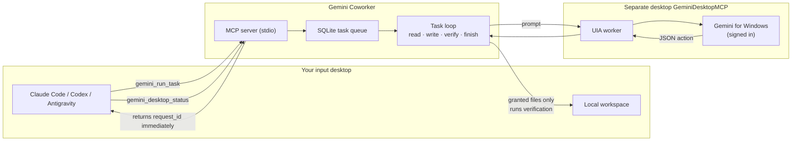

<div align="center">

# Gemini Coworker

**Let the Gemini desktop app do the work itself, in the background.**

Claude Code, Codex and Antigravity hand tasks to the **Gemini for Windows desktop app you are already signed in to**:

**It does the work itself**: not just answering questions, but reading code, editing files and running tests, and only reporting back once verification passes.<br/>
**It works in the background**: everything happens on a separate Win32 desktop. It never steals focus or touches your clipboard, so you keep working in your own chat and editor.

No API key needed. It uses the desktop app's existing sign-in.

[简体中文](README.md) · **English**


</div>

---

## What it does

| Capability | Description |
|---|---|
| **Gemini does the work itself** | Grant a task readable files, writable files and one verification command. Gemini reads the code, edits files and runs the tests on its own; the task only counts as done when verification passes |
| **In the background, without interrupting you** | The host gets a task ID back from `gemini_run_task` right away and keeps chatting. Gemini works on a separate desktop, never takes the foreground, and you fetch the result later |
| **Second-opinion review** | `gemini_review` sends a diff, files or a code snippet to Gemini for code review, debugging or architecture analysis |
| **Dedicated conversations** | `gemini_chat` talks to Gemini in a bound, dedicated conversation, optionally with local text files attached |
| **Uses the desktop app's sign-in** | No Gemini API key, and no dependency on the Gemini CLI |

## Why

You want to tell Codex "hand this subtask to Gemini and do it in the background", then keep talking about something else. None of the existing routes work well:

| Approach | Problem |
|---|---|
| Gemini API | Needs a separate key and billing; can't use the account you're signed in to in the desktop app |
| Gemini CLI | A separate sign-in and quota; behaves differently from the desktop app |
| Simulated keystrokes / borrowing the clipboard / grabbing the foreground and switching back | Interrupts whatever you're typing and pollutes your clipboard |
| UI Automation against a window on your normal desktop | In testing, writing a draft brought Gemini to the foreground |

Gemini Coworker creates a **separate Win32 desktop named `GeminiDesktopMCP`** inside the same Windows sign-in session and runs both the main Gemini instance and the UI Automation worker there. The input desktop is never switched, so your keystrokes always stay in your own windows.

> Tested on Gemini for Windows 1.21.1: the signed-in Gemini replied to a real handshake message in its dedicated conversation, passing the random ID, line break, four-space indentation and clipboard checks. The acceptance test listened for foreground-window events on the user's input desktop and never saw Gemini become the foreground window.

## How it works



1. The host calls `gemini_run_task`. The server returns a `request_id` in about 10 ms and the host carries on with the conversation.
2. The task enters a SQLite queue. On the separate desktop, the worker uses UI Automation to find the **bound, dedicated conversation** (its address is stored as a SHA-256 hash). It confirms which desktop the target window is on before sending, and keeps re-checking while it waits.
3. Tasks with a workspace go through the task loop: each turn Gemini replies with one JSON action, the server executes it locally and sends the result back as the next message (see below).
4. Later, the host calls `gemini_desktop_status(request_id=...)` to fetch the final answer. Long replies are paginated.
5. If the conversation has been switched, the window closed, the Gemini version changed, or several identical targets are found, the server refuses to guess and does not send.

## Letting Gemini do the work

On its own, the desktop Gemini can only chat. Gemini Coworker gives it a pair of supervised hands: dispatch a task with a `workspace_slug` and `permissions`, and Gemini can actually make the changes in your project.

```json
{
  "request_id": "fix-21",
  "session_id": "MCP-codex",
  "objective": "Fix the empty-string case in format and run the tests",
  "workspace_slug": "demo",
  "permissions": {
    "read_files": ["test/format.test.js"],
    "write_files": ["src/format.js"],
    "verify": { "command": "node", "args": ["--test", "test/format.test.js"] }
  }
}
```

Each turn, Gemini may reply with exactly one of four actions:

| Action | What the server does |
|---|---|
| `{"action":"read","path":"..."}` | Reads one granted file and sends it to Gemini after scrubbing secrets |
| `{"action":"write","path":"...","content":"..."}` | Writes a whole granted file, taking a Git snapshot first |
| `{"action":"verify"}` | Runs your verification command in the workspace and sends back the exit code and output |
| `{"action":"finish","answer":"..."}` | Ends the task and returns the answer, the list of changed files and the verification result |

Guardrails:

- **Granted files only**: read and write paths must appear in `read_files` / `write_files` and stay inside the workspace. Out-of-bounds requests are rejected and the error is sent back to Gemini.
- **Read before write**: an existing file must be read before it is edited, and its content hash must not have changed. If someone else modified it, Gemini is asked to read it again.
- **Done means verified**: when `verify` is set, `finish` checks that verification passed after the last write; otherwise the failing output goes back to Gemini to keep fixing.
- **Reversible**: every write is preceded by a Git snapshot that uses a separate index file, so your staging area is left alone.
- **Bounded**: files up to 128 KB, a 60-second timeout for the verification command, and at most 12 turns per task. `.json` files are validated before writing. For files containing secrets, Gemini only sees the scrubbed version and cannot write it back.
- **Without `permissions`**, Gemini delivers a text answer only.

> The verification command runs as the current user inside the workspace. Only specify commands and projects you trust.

Checking back and recovering:

- `gemini_desktop_status(request_id)` returns the status. When it returns `next_offset`, pass `offset` to read the next page.
- When reconnecting, reuse the original `request_id` and arguments. Reusing an ID with different input is rejected.
- If a message was sent but the outcome is unknown, the status is `needs_confirmation`; check the dedicated conversation by hand.
- Queued tasks can be cancelled with `cancel: true`.

## Requirements

- Windows 10 / 11 (Windows PowerShell 5.1, included with the OS)
- Node.js **22.13+**
- The [Gemini for Windows](https://support.google.com/gemini/answer/18263854) desktop app, installed and signed in

## Quick start

### 1. Install and build

```powershell
git clone https://github.com/xxxpixel-x/gemini-coworker-mcp.git
cd gemini-coworker-mcp
npm install
npm run build
npm test
```

### 2. Start Gemini on the separate desktop and bind a dedicated conversation

First save any drafts and **fully quit** Gemini on your normal desktop (a second launch with the same account wakes the existing instance instead of opening a new one).

```powershell
$env:GEMINI_DESKTOP_MODE='isolated'
npm run desktop:bind -- --start-isolated
npm run desktop:bind
```

The last command lists the Gemini windows on the separate desktop along with their handles. Pick one, bind it as a dedicated conversation and run the acceptance check:

```powershell
npm run desktop:bind -- MCP-codex <window-handle>
npm run desktop:bind -- --check MCP-codex isolated
```

Conversation names must look like `MCP-<label>`. For a blank chat, a fixed handshake message is sent first to obtain a stable conversation address; for an existing conversation, only its address is read.

### 3. Connect your MCP host

Replace the paths with your actual install location. **All hosts must use the same absolute `DATA_DIR`** to share the queue and bindings.

Use `--gemini-only` if you only want to delegate tasks without workspaces. To let Gemini edit code you need to register a workspace first, so use the default `--full` (see [Tools](#tools)).

<details open>
<summary><b>Codex</b> (<code>~/.codex/config.toml</code> or a project-level <code>.codex/config.toml</code>)</summary>

```toml
[mcp_servers.gemini_desktop]
command = "node"
args = ["C:/path/to/gemini-coworker-mcp/dist/index.js", "--stdio"]

[mcp_servers.gemini_desktop.env]
GEMINI_DESKTOP_MODE = "isolated"
DATA_DIR = "C:/path/to/gemini-coworker-mcp/.data"
ALLOWED_WORKSPACE_ROOTS = "C:/path/to/your/projects"
```

</details>

<details>
<summary><b>Claude Code</b></summary>

```powershell
claude mcp add gemini-desktop -e GEMINI_DESKTOP_MODE=isolated -e DATA_DIR=C:/path/to/gemini-coworker-mcp/.data -e ALLOWED_WORKSPACE_ROOTS=C:/path/to/your/projects -- node C:/path/to/gemini-coworker-mcp/dist/index.js --stdio
```

</details>

<details>
<summary><b>Antigravity and other hosts with JSON config</b></summary>

```json
{
  "mcpServers": {
    "gemini-desktop": {
      "command": "node",
      "args": ["C:/path/to/gemini-coworker-mcp/dist/index.js", "--stdio"],
      "env": {
        "GEMINI_DESKTOP_MODE": "isolated",
        "DATA_DIR": "C:/path/to/gemini-coworker-mcp/.data",
        "ALLOWED_WORKSPACE_ROOTS": "C:/path/to/your/projects"
      }
    }
  }
}
```

</details>

### 4. Start using it

Register a workspace once:

> Use workspace_manage to register C:/path/to/your/projects/my-app as workspace my-app.

Then hand off work directly:

> Hand "fix the empty-string case in format" to the Gemini desktop app in the background. Workspace my-app; it may edit src/format.js and read test/format.test.js, and should verify with `node --test test/format.test.js`.

Once the host has the `request_id`, you can talk about other things. A while later, say:

> Check the result of that Gemini task.

## Tools

`--gemini-only` exposes 5 Gemini tools; `--full` (the default) adds 9 local development tools, for 14 in total.

### Gemini desktop tools

| Tool | Purpose |
|---|---|
| `gemini_desktop_status` | Shows installation, running state, version, whether sign-in can be determined, bound conversations and acceptance status. With a `request_id`, it checks a task, reads paginated results (`offset`) or cancels a queued task (`cancel: true`) |
| `gemini_run_task` | Dispatches a task: an objective plus a stable `request_id`, with an optional workspace, granted files and one verification command |
| `gemini_chat` | Chats in a dedicated conversation, optionally attaching text files from allowed directories (scrubbed locally before sending) |
| `gemini_review` | Reviews, debugs or analyzes the architecture of a diff, files or a code snippet; follow-up reviews can reuse the same conversation |
| `gemini_sessions` | Reads or deletes local conversation history (the desktop app's token usage is not observable) |

### Local development tools (`--full`)

For the host agent to manage workspaces and to check and wrap up Gemini's changes.

| Tool | Purpose |
|---|---|
| `workspace_manage` | Registers workspaces; non-destructive snapshots and rollback using a separate `GIT_INDEX_FILE`; memory that persists across sessions |
| `code_explore` | Directory tree, search (prefers `rg`, falls back to a Node implementation), line-range reads, `git status` / `git diff`, reading saved artifacts |
| `code_patch` | Atomic multi-file patches (with `line_hint` support); automatic snapshot and secret scan before writing; automatic rollback when JSON validation fails |
| `workspace_exec` | Runs commands in a scrubbed environment; returns synchronously within 15 seconds and moves to a background job on timeout |
| `dispatch_agent` | Dispatches local `codex` / `claude_code` / `opencode` runs or plain shell tasks in the background |
| `job_status` | Shows background job logs and progress; `cancel: true` kills the whole process tree |
| `desktop_control` | System info, clipboard read/write, window list, notifications, opening targets; `run_powershell` is off by default |
| `github_inspect` | Read-only queries for repositories, PRs, issues and workflow runs (results wrapped in an untrusted-data boundary) |
| `publish_changes` | **The only external write gate**: commit and push, create PRs (draft by default), post comments; blocks direct pushes to `main`/`master` and sensitive files |

Built-in MCP prompts: `inspect_workspace` (get to know a project), `delegate_coding_task` (dispatch a local agent), `review_with_gemini` (have Gemini review the current diff).

## Desktop modes

| | `isolated` (recommended) | `interactive` (compatibility) |
|---|---|---|
| Where Gemini runs | Separate Win32 desktop `GeminiDesktopMCP` | Your normal desktop |
| Interrupts you? | Never took the foreground in testing | Writing a draft activated Gemini in testing |
| Default dispatch behavior | Returns `request_id` immediately | Waits up to 10 seconds; use `return_immediately=true` |
| Acceptance check | `--check <session> isolated` | Both `--check <session> other-app` and `personal-gemini` must pass |

> The default in code is `interactive`, for compatibility with older configs. For everyday use, set `GEMINI_DESKTOP_MODE=isolated` explicitly.

<details>
<summary>Manual acceptance steps for interactive mode</summary>

1. Open a dedicated test chat in its own Gemini window and run `npm run desktop:bind` to list candidate windows.
2. Bind it with `npm run desktop:bind -- MCP-codex <handle>`. Only bind your own dedicated test window.
3. Run `npm run desktop:bind -- --check MCP-codex other-app`, then within the 8-second countdown switch to another app and keep typing. Run it again with `personal-gemini`, switching to another Gemini window and typing in a personal conversation. Watch your drafts, message ownership and input focus at the same time; if any of them fails, the mode cannot be used as a background solution.
4. Query `gemini_desktop_status`. When sign-in state cannot be determined it returns `unknown`.

</details>

## Maintenance

- **After signing in to Windows again or closing Gemini**: repeat step 2 of the quick start. If the original dedicated conversation was restored, check `gemini_desktop_status` first; if a new blank chat appears, bind it under a new name:

  ```powershell
  npm run desktop:bind -- MCP-codex-next <window-handle>
  npm run desktop:bind -- --check MCP-codex-next isolated
  ```

- **After upgrading Gemini**: rerun the isolated acceptance check against the new version.
- **Going back to normal use**: wait for tasks to finish, quit the Gemini process on the separate desktop, then open Gemini from the Start menu.
- **While tasks are running**, keep the MCP server running.

## Configuration

See [.env.example](.env.example) for the full list.

| Variable | Default | Description |
|---|---|---|
| `GEMINI_DESKTOP_MODE` | `interactive` | `isolated` or `interactive` |
| `TOOL_PROFILE` | `full` | `full` (14 tools) or `gemini_only` (5); also `--full` / `--gemini-only` |
| `MCP_TRANSPORT` | `http` | `stdio` or `http`; also `--stdio` / `--http` |
| `DATA_DIR` | `<install dir>/.data` | SQLite database and artifacts directory; point all hosts at the same path |
| `ALLOWED_WORKSPACE_ROOTS` | Current working directory | Absolute directories allowed as workspaces and attachment sources, comma-separated |
| `DEFAULT_AGENT_DRIVER` | `codex` | Default driver for `dispatch_agent` |
| `ENABLE_DESKTOP_CONTROL` | `true` | Enables the Gemini desktop adapter and `desktop_control` |
| `ENABLE_DESKTOP_POWERSHELL` | `false` | Whether `desktop_control` may run arbitrary PowerShell |
| `GH_TOKEN` | empty | GitHub PAT; falls back to the local `gh` sign-in when empty |

## Remote MCP access (optional)

Besides stdio, the server can run over Streamable HTTP so that clients with remote MCP support can work on registered workspaces:

```powershell
npm run start:http
```

It listens on `http://127.0.0.1:8787/mcp` by default. To expose it, set `PUBLIC_DOMAIN` (an HTTPS address) and an auth mode in `.env`:

| `AUTH_MODE` | Description |
|---|---|
| `none` | No auth; **only allowed** on a loopback address, otherwise the server refuses to start |
| `bearer` | Static `Authorization: Bearer <MCP_BEARER_TOKEN>` |
| `oauth` | OAuth 2.1 + PKCE S256 + dynamic client registration; requires `OAUTH_SIGNING_SECRET` and `ADMIN_PASSWORD_HASH` (`.env.example` includes commands to generate them) |

Remote mode hands workspace read/write and command execution to remote clients. Use a strong admin password and put only the directories you need in `ALLOWED_WORKSPACE_ROOTS`.

## Security

- **Never switches the input desktop**: the separate desktop is opened without the `SWITCHDESKTOP` right, and the launcher never switches desktops.
- **Never guesses the target**: messages go only to a bound conversation whose address hash matches; any change in conversation aborts the send.
- **Gemini can only touch granted files**: the task loop checks every path, enforces read-before-write, the verification gate and the turn limit.
- **File boundaries**: workspace and attachment paths are confined to `ALLOWED_WORKSPACE_ROOTS`, with real-path resolution.
- **Secret protection**: files and diffs are scrubbed locally before being sent to Gemini, patches are scanned for secrets before writing, and child-process environments are scrubbed.
- **Untrusted-data boundary**: external content such as GitHub data is always returned inside a `<<<BEGIN_UNTRUSTED_DATA>>>` block.
- **Single gate for external writes**: every GitHub write goes through `publish_changes`, which is always marked destructive so the host asks for confirmation.

## Known limitations

- Windows only, and dependent on the current UI Automation structure of the Gemini desktop app; app upgrades may require a new acceptance check or adaptation.
- The task loop reads and writes whole files with a 128 KB per-file limit, so it is not suited to refactoring large files.
- The desktop app's token usage is not observable.
- Normal-desktop (`interactive`) mode activated the Gemini window on the tested version and is not suitable as a background solution.
- While the separate desktop is running, you cannot open a second Gemini instance with the same account on your normal desktop.
- This project drives an app you are signed in to through UI automation. Make sure your usage complies with Google's terms of service.

## Project structure

```
src/
  index.ts              Entry point; parses --stdio / --http / --full / --gemini-only
  desktopBind.ts        The npm run desktop:bind CLI
  core/
    desktopGateway.ts   Gemini desktop adapter: start, bind, check, queue, results
    desktopTask.ts      Task loop that lets Gemini read/write files and run verification
    geminiReview.ts     Review prompts and diff collection
    agentRunner.ts      codex / claude_code / opencode dispatch
    codeTools.ts        Search, read, patch
    gitSnapshot.ts      Non-destructive Git snapshots
    githubService.ts    Read-only GitHub queries and the publish gate
  mcp/                  Tool registry, output guard, built-in prompts, stdio / HTTP server
  auth/                 OAuth 2.1 for HTTP mode
  db/sqlite.ts          Tasks, conversations, bindings, acceptance records
native/
  IsolatedDesktop.cs    Creates the separate desktop and launches processes on it (P/Invoke)
  gemini-uia.ps1        UI Automation worker
docs/                   Design notes and normal-desktop test records (Chinese)
tests/                  Vitest tests
```

## Development

```powershell
npm run dev:stdio     # run stdio mode directly with tsx
npm run dev:http      # run HTTP mode with tsx watch
npm run typecheck
npm test
```

To add a tool, call `registry.register({...})` under `src/mcp/tools/` and register it for the appropriate profile in `src/mcp/tools/index.ts`.

## Disclaimer

This is an independent community project. It is not affiliated with, endorsed by, or supported by Google. Gemini is a trademark of Google LLC.

## License

[MIT](LICENSE)
