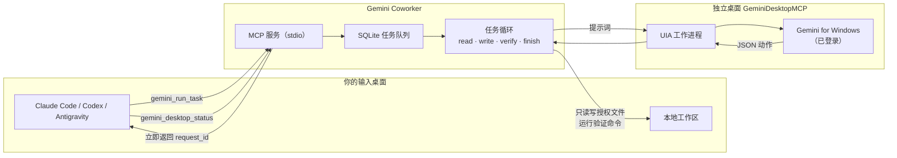

<div align="center">

# Gemini Coworker

**让 Gemini 桌面版在后台自己干活。**

Claude Code、Codex、Antigravity 把任务交给**已登录的 Gemini for Windows 桌面 App**：

**它自己干活**：不只是回答问题，而是自己读代码、改文件、跑测试，验证通过才交差。<br/>
**它在后台干**：整个过程在一个独立的 Win32 桌面里进行，不抢焦点、不碰剪贴板，你在原来的聊天和编辑器里继续工作。

不用 API Key，直接用桌面 App 已登录的账号。


</div>

---

## 它能做什么

| 能力 | 说明 |
|---|---|
| **让 Gemini 自己干活** | 给任务授权可读文件、可写文件和一条验证命令，Gemini 会自己读代码、改文件、跑测试，验证通过才算完成 |
| **在后台干，不打扰你** | 宿主调用 `gemini_run_task` 后立即拿到任务编号，继续聊别的；Gemini 在独立桌面里干活，不抢前台，稍后再取回结果 |
| **第二意见评审** | `gemini_review` 把 diff、文件或代码片段交给 Gemini 做评审、调试或架构分析 |
| **专用会话对话** | `gemini_chat` 在绑定好的专用会话里对话，可附带本地文本文件 |
| **用桌面 App 的登录态** | 不需要 Gemini API Key，也不依赖 Gemini CLI |

## 为什么做这个

你想对 Codex 说一句「把这个子任务交给 Gemini，后台做」，然后接着聊别的。现有路径都不理想：

| 方案 | 问题 |
|---|---|
| Gemini API | 需要单独的 Key 和计费，用不上桌面 App 已登录的账号 |
| Gemini CLI | 另一套登录和配额，行为和桌面 App 不同 |
| 模拟键盘 / 借剪贴板 / 抢前台再切回 | 打断你正在打的字，污染剪贴板 |
| 直接对普通桌面上的窗口做 UI Automation | 实测写入草稿后 Gemini 会被激活到前台 |

Gemini Coworker 在同一个 Windows 登录会话里创建一个**名为 `GeminiDesktopMCP` 的独立 Win32 桌面**，把 Gemini 主实例和 UI Automation 工作进程都放进去。输入桌面从不切换，你的键盘输入始终留在你自己的窗口里。

> 已在 Gemini for Windows 1.21.1 上实测：已登录的 Gemini 在专用会话里回复了真实握手消息，随机编号、换行、四空格缩进、剪贴板检查全部通过；验收程序在用户输入桌面上监听前台窗口事件，全程未检测到 Gemini 成为前台窗口。

## 工作原理



1. 宿主调用 `gemini_run_task`，服务在约 10 ms 内返回 `request_id`，宿主立刻继续对话。
2. 任务进入 SQLite 队列。工作进程在独立桌面上通过 UI Automation 找到**已绑定的专用会话**（会话地址以 SHA-256 哈希存储），发送前确认目标窗口所在的桌面，等待期间持续复核。
3. 带工作区的任务进入任务循环：Gemini 每轮回复一个 JSON 动作，服务在本地执行，再把结果作为下一轮消息发回给 Gemini（见下文）。
4. 宿主之后用 `gemini_desktop_status(request_id=...)` 取回最终答案，长回复分页读取。
5. 会话被切换、窗口关闭、Gemini 版本变化或出现多个相同目标时，服务拒绝猜测发送。

## 让 Gemini 动手干活

普通的桌面 Gemini 只能聊天。Gemini Coworker 给它接上了一个受控的「手」：派发任务时带上 `workspace_slug` 和 `permissions`，Gemini 就能在你的项目里真正完成修改。

```json
{
  "request_id": "fix-21",
  "session_id": "MCP-codex",
  "objective": "修复 format 的空字符串用例并运行测试",
  "workspace_slug": "demo",
  "permissions": {
    "read_files": ["test/format.test.js"],
    "write_files": ["src/format.js"],
    "verify": { "command": "node", "args": ["--test", "test/format.test.js"] }
  }
}
```

Gemini 每轮只能回复下面四种动作之一：

| 动作 | 服务端做什么 |
|---|---|
| `{"action":"read","path":"..."}` | 读取一个授权文件，脱敏后发给 Gemini |
| `{"action":"write","path":"...","content":"..."}` | 整文件写入一个授权文件，写前自动做 Git 快照 |
| `{"action":"verify"}` | 在工作区里运行你指定的验证命令，把退出码和输出发回去 |
| `{"action":"finish","answer":"..."}` | 结束任务，返回答案、改动文件列表和验证结果 |

护栏：

- **只碰授权文件**：读写路径必须在 `read_files` / `write_files` 里，并且限制在工作区内；越界请求直接驳回，并把错误告诉 Gemini。
- **先读后写**：修改已有文件前必须先读过，且文件内容的哈希没变；被别人改过就要求重新读取。
- **验证通过才算完成**：设置了 `verify` 时，`finish` 前会确认最后一次写入之后验证通过，否则把失败输出发回给 Gemini 继续修。
- **可回滚**：每次写入前自动做 Git 快照，快照使用独立的索引文件，不影响你的暂存区。
- **有边界**：单文件不超过 128 KB，验证命令超时 60 秒，每个任务最多 12 轮；`.json` 文件写入前校验格式；含密钥的文件 Gemini 只能看到脱敏版本，也不能写回。
- **不传 `permissions` 时**，Gemini 只交付文字答案。

> 验证命令以当前用户身份在工作区内执行，请只指定你信任的命令和项目。

续查与恢复：

- `gemini_desktop_status(request_id)` 查询状态；返回 `next_offset` 时带上 `offset` 读下一页。
- 断线重连时沿用原 `request_id` 和原参数；同一编号配不同输入会被拒绝。
- 已发送但结果不明时状态为 `needs_confirmation`，请到专用会话人工核对。
- 排队中的任务可用 `cancel: true` 取消。

## 环境要求

- Windows 10 / 11（Windows PowerShell 5.1，系统自带）
- Node.js **22.13+**
- 已安装并登录的 [Gemini for Windows](https://support.google.com/gemini/answer/18263854) 桌面 App

## 快速开始

### 1. 安装与构建

```powershell
git clone https://github.com/<your-name>/gemini-coworker-mcp.git
cd gemini-coworker-mcp
npm install
npm run build
npm test
```

### 2. 在独立桌面启动 Gemini 并绑定专用会话

先保存草稿并**完全退出**普通桌面上的 Gemini（同一账号的第二次启动会唤起已有实例，而不是新开一个）。

```powershell
$env:GEMINI_DESKTOP_MODE='isolated'
npm run desktop:bind -- --start-isolated
npm run desktop:bind
```

最后一条命令会列出独立桌面里的 Gemini 窗口及句柄。选一个窗口，绑定为专用会话并跑一次验收：

```powershell
npm run desktop:bind -- MCP-codex <窗口句柄>
npm run desktop:bind -- --check MCP-codex isolated
```

会话名必须形如 `MCP-<label>`。空白聊天会先发送一条固定握手消息来取得稳定的会话地址；已有对话只读取地址。

### 3. 接入 MCP 宿主

把路径换成你的实际安装位置。**所有宿主使用同一个绝对 `DATA_DIR`**，才能共用队列和绑定。

只想委派任务、不需要工作区时用 `--gemini-only`；要让 Gemini 改代码，需要先注册工作区，用默认的 `--full`（见下文「工具」）。

<details open>
<summary><b>Codex</b>（<code>~/.codex/config.toml</code> 或项目内 <code>.codex/config.toml</code>）</summary>

```toml
[mcp_servers.gemini_desktop]
command = "node"
args = ["C:/path/to/gemini-coworker-mcp/dist/index.js", "--stdio"]

[mcp_servers.gemini_desktop.env]
GEMINI_DESKTOP_MODE = "isolated"
DATA_DIR = "C:/path/to/gemini-coworker-mcp/.data"
ALLOWED_WORKSPACE_ROOTS = "C:/path/to/your/projects"
```

</details>

<details>
<summary><b>Claude Code</b></summary>

```powershell
claude mcp add gemini-desktop -e GEMINI_DESKTOP_MODE=isolated -e DATA_DIR=C:/path/to/gemini-coworker-mcp/.data -e ALLOWED_WORKSPACE_ROOTS=C:/path/to/your/projects -- node C:/path/to/gemini-coworker-mcp/dist/index.js --stdio
```

</details>

<details>
<summary><b>Antigravity 及其他 JSON 配置的宿主</b></summary>

```json
{
  "mcpServers": {
    "gemini-desktop": {
      "command": "node",
      "args": ["C:/path/to/gemini-coworker-mcp/dist/index.js", "--stdio"],
      "env": {
        "GEMINI_DESKTOP_MODE": "isolated",
        "DATA_DIR": "C:/path/to/gemini-coworker-mcp/.data",
        "ALLOWED_WORKSPACE_ROOTS": "C:/path/to/your/projects"
      }
    }
  }
}
```

</details>

### 4. 开始使用

先注册一次工作区：

> 用 workspace_manage 把 C:/path/to/your/projects/my-app 注册成工作区 my-app。

然后直接派活：

> 把「修复 format 的空字符串用例」交给 Gemini 桌面版在后台做，工作区 my-app，允许它改 src/format.js、读 test/format.test.js，用 `node --test test/format.test.js` 验证。

宿主拿到 `request_id` 后，你可以继续聊别的。过一会儿再说：

> 看看刚才 Gemini 的结果。

## 工具

`--gemini-only` 暴露 5 个 Gemini 工具；`--full`（默认）再加 9 个本机研发工具，共 14 个。

### Gemini 桌面工具

| 工具 | 作用 |
|---|---|
| `gemini_desktop_status` | 查看安装、运行、版本、登录可判定性、已绑定会话和验收状态；传 `request_id` 时查询任务、分页读取结果（`offset`）或取消排队任务（`cancel: true`） |
| `gemini_run_task` | 派发任务：目标描述 + 稳定的 `request_id`，可选工作区、授权文件和一条验证命令 |
| `gemini_chat` | 在专用会话里对话，可附带允许目录内的文本文件（发送前本地脱敏） |
| `gemini_review` | 针对 diff、文件或代码片段做评审、调试或架构分析，可在同一会话复审 |
| `gemini_sessions` | 读取、删除本地会话历史（桌面 App 的 Token 用量不可观测） |

### 本机研发工具（`--full`）

供宿主 Agent 管理工作区、配合 Gemini 的改动做检查和收尾。

| 工具 | 作用 |
|---|---|
| `workspace_manage` | 注册工作区；基于独立 `GIT_INDEX_FILE` 的非破坏性快照与回滚；跨会话持久记忆 |
| `code_explore` | 目录树、搜索（优先 `rg`，否则回退 Node 实现）、按行读取、`git status` / `git diff`、读取落盘产物 |
| `code_patch` | 原子多文件补丁（支持 `line_hint`）；写前自动快照和密钥扫描；JSON 校验失败自动回滚 |
| `workspace_exec` | 在脱敏环境运行命令，15 秒内同步返回，超时自动转为后台任务 |
| `dispatch_agent` | 后台派发本机 `codex` / `claude_code` / `opencode` 或普通 shell 任务 |
| `job_status` | 查看后台任务日志和进度，`cancel: true` 时结束整个进程树 |
| `desktop_control` | 系统信息、剪贴板读写、窗口列表、通知、打开目标；`run_powershell` 默认关闭 |
| `github_inspect` | 只读查询仓库、PR、Issue、Workflow 运行（结果加不可信数据边界） |
| `publish_changes` | **唯一的外部写入闸门**：提交推送、创建 PR（默认 draft）、发评论；拦截直推 `main`/`master` 和敏感文件 |

内置 MCP Prompt：`inspect_workspace`（摸清项目）、`delegate_coding_task`（派发本机 Agent）、`review_with_gemini`（让 Gemini 评审当前 diff）。

## 两种桌面模式

| | `isolated`（推荐） | `interactive`（兼容） |
|---|---|---|
| Gemini 运行位置 | 独立 Win32 桌面 `GeminiDesktopMCP` | 你的普通桌面 |
| 是否打断用户 | 实测不抢前台 | 实测写入草稿后 Gemini 会被激活 |
| 派发默认行为 | 立即返回 `request_id` | 最多等待 10 秒，可用 `return_immediately=true` |
| 验收 | `--check <会话> isolated` | `--check <会话> other-app` 与 `personal-gemini` 都要通过 |

> 代码里的默认值是 `interactive`，以兼容旧配置。日常使用请显式设置 `GEMINI_DESKTOP_MODE=isolated`。

<details>
<summary>interactive 模式的人工验收步骤</summary>

1. 在独立的 Gemini 窗口打开一个专用测试聊天，运行 `npm run desktop:bind` 列出候选窗口。
2. `npm run desktop:bind -- MCP-codex <句柄>` 绑定。只把你自己的专用测试窗口用于绑定。
3. 运行 `npm run desktop:bind -- --check MCP-codex other-app`，在 8 秒倒计时内切到其他应用并持续输入；再用 `personal-gemini` 跑一次，切到另一个 Gemini 窗口在个人会话里输入。人工同时观察草稿、消息归属和输入焦点，任一项失败都不能当作后台方案使用。
4. 查询 `gemini_desktop_status`。登录状态无法判断时返回 `unknown`。

</details>

## 日常维护

- **Windows 重新登录或 Gemini 关闭后**：重新执行快速开始第 2 步。如果原专用会话已恢复，先用 `gemini_desktop_status` 看状态；出现新的空白聊天时，用一个新会话名绑定：

  ```powershell
  npm run desktop:bind -- MCP-codex-next <窗口句柄>
  npm run desktop:bind -- --check MCP-codex-next isolated
  ```

- **升级 Gemini 后**：对新版本重新运行隔离验收。
- **恢复普通使用**：等任务结束，退出独立桌面里的 Gemini 进程，再从开始菜单打开 Gemini。
- **任务执行期间**保持 MCP 服务运行。

## 主要配置

完整列表见 [.env.example](.env.example)。

| 变量 | 默认值 | 说明 |
|---|---|---|
| `GEMINI_DESKTOP_MODE` | `interactive` | `isolated` 或 `interactive` |
| `TOOL_PROFILE` | `full` | `full`（14 个工具）或 `gemini_only`（5 个），也可用 `--full` / `--gemini-only` |
| `MCP_TRANSPORT` | `http` | `stdio` 或 `http`，也可用 `--stdio` / `--http` |
| `DATA_DIR` | `<安装目录>/.data` | SQLite 数据库和产物目录，多个宿主请指向同一路径 |
| `ALLOWED_WORKSPACE_ROOTS` | 当前工作目录 | 允许作为工作区和附件来源的绝对目录，逗号分隔 |
| `DEFAULT_AGENT_DRIVER` | `codex` | `dispatch_agent` 默认驱动 |
| `ENABLE_DESKTOP_CONTROL` | `true` | 启用 Gemini 桌面适配器和 `desktop_control` |
| `ENABLE_DESKTOP_POWERSHELL` | `false` | 是否允许 `desktop_control` 执行任意 PowerShell |
| `GH_TOKEN` | 空 | GitHub PAT；为空时回退到本机 `gh` 登录态 |

## 远程 MCP 访问（可选）

除了 stdio，服务也能以 Streamable HTTP 运行，让支持远程 MCP 的客户端操作已注册的工作区：

```powershell
npm run start:http
```

默认监听 `http://127.0.0.1:8787/mcp`。对外暴露时在 `.env` 里设置 `PUBLIC_DOMAIN`（HTTPS 地址）和认证方式：

| `AUTH_MODE` | 说明 |
|---|---|
| `none` | 无认证，**仅允许**绑定回环地址，否则拒绝启动 |
| `bearer` | 静态 `Authorization: Bearer <MCP_BEARER_TOKEN>` |
| `oauth` | OAuth 2.1 + PKCE S256 + 动态客户端注册，需要 `OAUTH_SIGNING_SECRET` 和 `ADMIN_PASSWORD_HASH`（`.env.example` 里有生成命令） |

远程模式会把工作区读写和命令执行能力交给远程客户端，请使用强管理员密码，只把需要的目录放进 `ALLOWED_WORKSPACE_ROOTS`。

## 安全设计

- **不切换输入桌面**：独立桌面以不含 `SWITCHDESKTOP` 的权限打开，启动器从不调用桌面切换。
- **不猜测目标**：只向已绑定且地址哈希匹配的 Gemini 会话发送，会话变化即中止。
- **Gemini 只能碰授权文件**：任务循环逐条校验路径、先读后写、验证门槛和轮数上限。
- **文件边界**：工作区和附件路径都限制在 `ALLOWED_WORKSPACE_ROOTS` 内，并做真实路径解析。
- **密钥保护**：文件和 diff 发给 Gemini 前在本地脱敏，补丁写入前扫描密钥，子进程环境变量脱敏。
- **不可信数据边界**：来自 GitHub 等外部的内容一律包在 `<<<BEGIN_UNTRUSTED_DATA>>>` 块中返回。
- **外部写入单一闸门**：所有 GitHub 写操作只能经 `publish_changes`，该工具始终标记为破坏性，宿主会要求确认。

## 已知限制

- 仅支持 Windows，且依赖 Gemini 桌面 App 当前的 UI Automation 结构，App 升级后可能需要重新验收或适配。
- 任务循环按整文件读写，单文件上限 128 KB，不适合大文件重构。
- 桌面 App 的 Token 用量不可观测。
- 普通桌面（`interactive`）模式在实测版本上会激活 Gemini 窗口，不适合作为后台方案。
- 独立桌面运行期间，普通桌面无法再开一个同账号的 Gemini 实例。
- 本项目通过 UI 自动化操作你自己已登录的 App，请自行确认使用方式符合 Google 的服务条款。

## 项目结构

```
src/
  index.ts              入口，解析 --stdio / --http / --full / --gemini-only
  desktopBind.ts        npm run desktop:bind 命令行
  core/
    desktopGateway.ts   Gemini 桌面适配器：启动、绑定、验收、队列、结果
    desktopTask.ts      让 Gemini 读写文件、跑验证的任务循环
    geminiReview.ts     评审提示词与 diff 收集
    agentRunner.ts      codex / claude_code / opencode 派发
    codeTools.ts        搜索、读取、补丁
    gitSnapshot.ts      非破坏性 Git 快照
    githubService.ts    GitHub 只读查询与发布闸门
  mcp/                  工具注册、输出保护、内置 Prompt、stdio / HTTP 服务
  auth/                 HTTP 模式的 OAuth 2.1
  db/sqlite.ts          任务、会话、绑定、验收记录
native/
  IsolatedDesktop.cs    创建独立桌面并在其中启动进程（P/Invoke）
  gemini-uia.ps1        UI Automation 工作进程
docs/                   设计讨论与普通桌面测试记录
tests/                  Vitest 测试
```

## 开发

```powershell
npm run dev:stdio     # tsx 直接运行 stdio 模式
npm run dev:http      # tsx watch 运行 HTTP 模式
npm run typecheck
npm test
```

新增工具：在 `src/mcp/tools/` 下调用 `registry.register({...})`，并在 `src/mcp/tools/index.ts` 中按档位注册。

## 免责声明

本项目是独立的社区项目，与 Google 无关联，也未获得 Google 的认可或支持。Gemini 是 Google LLC 的商标。

## License

[MIT](LICENSE)
